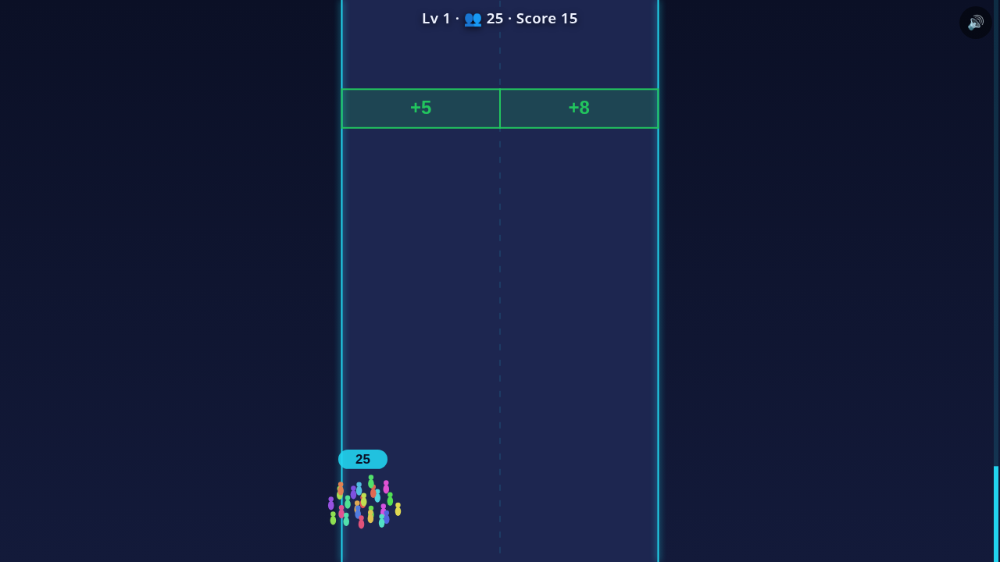

# Crowd Clash

**Steer your running crowd through math gates, dodge spike traps, and crush the enemy crowd at the finish line.**

▶ **Play in the browser:** https://abhi478jeetur-rgb.github.io/crowd-clash/
(Phone-first, portrait 9:16 — no install, no downloads.)

## How to play

- **Steer:** drag, mouse, or `←` / `→` arrow keys (`A` / `D`). `Space` / `Enter` starts.
- **Gates:** every gate pair offers two operations — `+15` vs `×2`, `−30` vs `+25`. Your crowd count changes as you pass. The better gate depends on your *current* crowd size, so the math stays live.
- **Traps & bonuses:** spike strips eat runners; golden drums add them. Cross on the safe line.
- **Final clash:** at the finish, your crowd battles the enemy crowd. Bigger number wins — barely winning earns 1★, a stomp earns 3★.
- **10 levels**, enemy crowds from 25 to 4,500. Unlocks and stars are saved in your browser.

## Built with OpenGame

Created and verified with the [OpenGame](https://github.com/nexu-io/opengame) studio (OpenMotion MCP):
deterministic `logic.js` rules with a built-in pilot player, proven by automated gates —
skilled play wins, idle play loses, always-left play dies mid-run — plus a headless-Chrome
playtest with zero console errors. All art is procedural canvas and all audio is synthesized
WebAudio: no external assets, no build step.

## Run locally

Any static server works, e.g. `npx serve .` — then open `index.html`.
The game logic (`logic.js`) is a pure deterministic module; `client.js` is the canvas/WebAudio presentation layer.

## License

MIT
